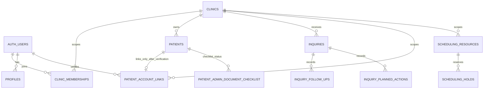
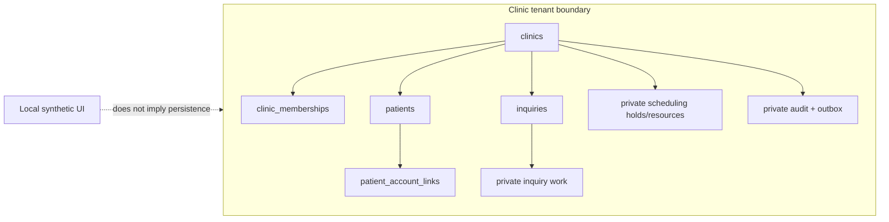

# SaaS schema and module readiness map

**Read-only inventory checked:** 29 October 2026
**Purpose:** explain which Supabase project is open, which project the current repository targets, what the tenant foundation covers, and where module work can safely split. This is an inventory, not a complete ERD or approval to change a hosted database.

## The short answer

There is no single “whole project schema” yet. The repository has a real multi-tenant foundation and a growing set of bounded operational domains, but it does not have a complete database model for every PRD module. Consultation/clinical records and connected finance are not implemented. Several visible screens are synthetic local demos and do not persist to Supabase.

The Supabase dashboard currently open in the browser is project `dbnxfqjevdffgrkvczli` (`DentalSpa V1`). A separate development project, `giufpdppsunryyhfnzps` (`DentalSpa OS Dev`), is the one referenced by the current hosted-foundation records in this repository. They are different projects with different schemas:

| Source | Read-only snapshot | What it means |
| --- | --- | --- |
| Open dashboard: `dbnxfqjevdffgrkvczli` | 7 migration-ledger rows; 11 `public` tables | Older generic schema (`memberships`, JSONB `data` on patients/appointments/tasks/journeys/documents/messages). It is not the current repository schema. |
| Repository development project: `giufpdppsunryyhfnzps` | 19 migration-ledger rows; 30 application tables, of which 6 are in `public` and 24 in `private` | The hosted foundation and intake/scheduling subset. The dashboard’s normal `public` view therefore shows six app tables; private operational tables require selecting the `private` schema. |
| Current checkout at 2026-10-30 | 26 local SQL migrations | Seven migrations are newer than the 19-migration hosted ledger snapshot recorded on 2026-10-29. The current local sequence was applied to embedded PostgreSQL for compatibility checking; this does not reconcile or authorize any hosted migration. |

## Current local checkout schema — 2026-10-30

This is the schema defined by the current repository's 26 ordered SQL files, not a claim about either Supabase project. A fresh PGlite instance successfully applied all 26 files and the repository seed. The migration test used small `auth`/`storage` schema stubs and installed `btree_gist`; it is not the Supabase runtime and does not verify native RLS execution, pgTAP or independent database sessions.

The checkout defines **40 application tables: 6 in `public` and 34 in `private`**. The public set is exposed by the local Data API configuration. Private tables are intentionally absent from that exposed schema and direct client access is revoked; their operations go through authorized API/RPC boundaries. In the Supabase dashboard, selecting only `public` therefore hides private tables by design.

| Schema / domain | Tables in the current migration chain |
| --- | --- |
| `public` tenant and records (6) | `clinics`, `profiles`, `clinic_memberships`, `patients`, `patient_account_links`, `inquiries` |
| `private` audit and delivery (5) | `audit_events`, `outbox_events`, `consumed_events`, `outbox_deliveries`, `outbox_attempts` |
| `private` intake controls (2) | `intake_command_settings`, `intake_idempotency` |
| `private` inquiry follow-up and ownership (4) | `inquiry_follow_ups`, `inquiry_follow_up_idempotency`, `inquiry_owner_reassignment_idempotency`, `inquiry_schedule_receipts` |
| `private` inquiry preferences and history (11) | `inquiry_contact_preferences`, `inquiry_contact_preference_receipts`, `inquiry_communication_languages`, `inquiry_communication_language_receipts`, `inquiry_communication_time_zones`, `inquiry_communication_time_zone_receipts`, `inquiry_planned_actions`, `inquiry_planned_action_receipts`, `inquiry_contact_outcomes`, `inquiry_contact_outcome_idempotency`, `inquiry_contact_outcome_settings` |
| `private` patient preferences (3) | `patient_communication_preferences`, `patient_communication_preference_receipts`, `patient_communication_settings` |
| `private` manual document checklist (3) | `patient_admin_document_checklist`, `patient_admin_document_checklist_receipts`, `patient_admin_document_checklist_settings` |
| `private` scheduling (6) | `scheduling_settings`, `scheduling_resources`, `scheduling_windows`, `scheduling_holds`, `scheduling_occupancy`, `scheduling_idempotency` |

The main tenant relationships are `clinics → clinic_memberships`, `clinics → patients`, and `clinics → inquiries`; `patient_account_links` links an authenticated account to one clinic-scoped patient only after verification. Operational inquiry history and scheduling rows use clinic scope and server-side authorization. Their existence does not mean that every workflow is enabled: contact outcomes and patient checklist writes remain default-off, while appointment confirmation and identity association remain blocked by their policy tasks.

The diagram shows the core domain shape, not every receipt/settings/audit table or authorization predicate. The exact private table inventory is listed above. For each connected action, inspect its migration, role policy and RPC tests; table presence alone does not establish feature acceptance.

The dashboard is not showing a “missing table” failure when it lists six `public` tables in the development project: the private tables are intentionally outside the exposed Data API schema. `private` does not mean that application authorization can be skipped; the API/RPC layer still enforces clinic membership and every tenant-owned row remains clinic-scoped.

## What exists in the development project

### Public schema (6)

`clinics`, `profiles`, `clinic_memberships`, `patients`, `patient_account_links`, `inquiries`.

These cover clinic identity, staff/account identity and active clinic roles, a normalized patient registry and account-link boundary, and the separate administrative inquiry/pipeline record. The inquiry record is deliberately not a patient record and has no clinical-note or diagnosis payload.

### Private schema (24)

- Audit and event delivery: `audit_events`, `outbox_events`, `consumed_events`, `outbox_deliveries`, `outbox_attempts`.
- Intake controls: `intake_command_settings`, `intake_idempotency`.
- Scheduling preview/command foundation: `scheduling_settings`, `scheduling_resources`, `scheduling_windows`, `scheduling_holds`, `scheduling_occupancy`, `scheduling_idempotency`.
- Inquiry work: `inquiry_follow_ups`, `inquiry_follow_up_idempotency`, `inquiry_schedule_receipts`, `inquiry_contact_preferences`, `inquiry_contact_preference_receipts`, `inquiry_communication_languages`, `inquiry_communication_language_receipts`, `inquiry_communication_time_zones`, `inquiry_communication_time_zone_receipts`, `inquiry_planned_actions`, `inquiry_planned_action_receipts`.

All 30 application tables returned RLS enabled in the read-only inventory. That is useful foundation evidence; it does not by itself prove every positive and cross-tenant behavior, nor does it turn demo UI into connected workflows.

## What the current checkout adds

The 26 checked-in migrations group into these bounded domains:

| Domain | Present in local migrations / contracts | Product boundary today |
| --- | --- | --- |
| SaaS identity and tenant core | Clinics, profiles, `clinic_memberships`, patient/account association boundary, RLS and tenant-safe references | Verified clinic membership is the authority source; caller-supplied clinic IDs are never sufficient authorization. |
| Operational reliability | Private audit, transactional outbox, idempotency receipts, privilege hardening | Foundation exists; not every module emits or consumes events yet. |
| Patient inquiry/pipeline administration (M01) | Manual intake, lookup, owner/worklist, follow-up schedule/history, contact preferences/language/time zone, planned actions/history, reassignment, factual contact-outcome contract/API/SQL draft | Useful partial workflow. Qualification, reviewed identity association/conversion and connected outcome activation remain incomplete/gated. |
| Scheduling (M02) | Private resources, windows, holds, occupancy and concurrency-safe hold/release path | A hold is not a confirmed appointment. Confirmation, cancellation/reschedule rules and actual clinic-approved resource rules are still open. |
| Patient Pass (M03) | Patient/account link boundary, guarded own-profile read/audit, local Moroccan synthetic scenarios and UI previews | PWA demo is not a complete connected patient portal; no real appointment, released clinical record, document or message feed is implied. |
| Consultation/clinical record (M04) | No complete encounter/note/treatment-plan schema or workflow | Planned/preview UI only. Clinical data model and transitions need clinician review; none should be invented by a module team. |
| Finance/payments (M14) | No connected finance ledger, invoice, payment, refund or reconciliation schema | Fictional walkthrough only. Financial rules and accounting fields need owner/accounting decisions first. |
| Team/operations (M16) | Partial roster/activity foundation and safe local access/delegation previews | Does not establish qualifications, shift coverage or clinical authority. |

The 2026-10-29 hosted snapshot records 19 migration-ledger entries, while the current 2026-10-30 checkout has 26 files. The newer local work includes additional audit/activity, inquiry-outcome, communication-preference and checklist preparation. Outcome and checklist write gates remain off pending their local/runtime and privacy decisions. This inventory does not authorize applying the seven-file difference to either Supabase project.

## Why the whole schema should not be created upfront

The SaaS foundation can and should be shared, but a giant guessed schema would lock in unknown clinic processes, privacy retention, clinical decisions and money rules. A table count is not the same thing as functional module coverage. The current architecture grows reviewed, versioned domain slices on top of a stable tenant boundary; each slice adds migration, API contract, role policy, audit behavior and test evidence together.

For the MVP, the shared contracts to freeze before splitting module teams are:

1. Tenant identity: authenticated actor, selected active clinic, membership/role, default-deny access and cross-tenant reference rules.
2. Module API/event boundaries: generated OpenAPI/shared contracts, stable IDs, error/version semantics and which domain owns each write.
3. Reliability: idempotency key, transactional audit/outbox behavior and replay expectations for consequential commands.
4. Readiness convention: distinguish synthetic preview, local persisted workflow, connected dev implementation and release-approved capability in Build Center evidence.

## Safe parallel team boundaries

Parallel work is effective once these shared contracts are frozen and ownership is disjoint. Keep one coordinator responsible for dependency decisions, generated contracts, migration ordering and final integration; module teams must not edit the same migration/API contract concurrently.

| Team lane | Can proceed now | Must not assume |
| --- | --- | --- |
| Inquiry/patient pipeline | Finish bounded administrative owner/worklist/history and demo continuity; keep prospect separate from patient | Identity verification, urgency/triage, clinical qualification, conversion, outcome retention or messaging authority without approved decisions |
| Scheduling | Continue demo flow and separately specify confirmation/cancel/reschedule contract | A hold is a booking; real clinic hours, resource mappings, durations or urgent-care policy |
| Patient Pass | Improve synthetic preview and test own-account boundary | Any patient can see internal content; appointment, clinical record, document or message is released merely because it exists |
| Consultation | Clinician-led discovery and non-persisting synthetic walkthrough | Note sections, diagnoses, treatment-plan states, instructions or mandatory clinical steps |
| Finance | Owner/accountant-led discovery and fictional demo walkthrough | Invoice/tax/payment/refund/reconciliation rules or any clinically consequential financial transition |
| Foundation/API | Continue tenant isolation, workspace selection, audit, idempotency and integration checks | Service-role access automatically inheriting RLS or a caller-provided tenant ID being trustworthy |

Suggested build order: (1) publish and freeze the shared tenant/API/event contracts; (2) finish one end-to-end administrative MVP slice and its synthetic demo; (3) build pipeline, scheduling, Patient Pass and team UI/API work in disjoint lanes; (4) only after named reviewers approve rules, design consultation and finance schemas; (5) integrate every lane on one branch head and run the combined isolation, transition and browser evidence before declaring features complete.

## Release and safety gates

- No hosted schema mutation in this audit; the two project snapshots above were read-only.
- Reconcile the `dbnxfq…` project identity and old migration lineage before considering its schema for the current app. Keep the application pointed at the explicitly designated dev project.
- Reconcile local 25 versus hosted 19 migration history before any hosted migration command; never blindly replay the local directory.
- Patient/clinical retention and publication require privacy and licensed-clinician review. Finance rules require the clinic owner/accounting review. Until then, keep those workflows synthetic or non-persisting.
- Use the repository's queue, ADR-003 and module progress evidence as delivery source of truth. A passing build does not mean a PRD capability is complete.
